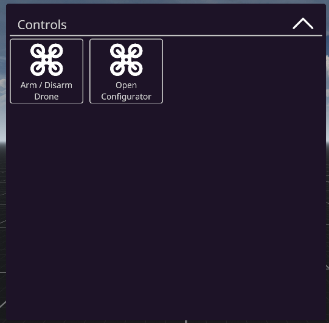
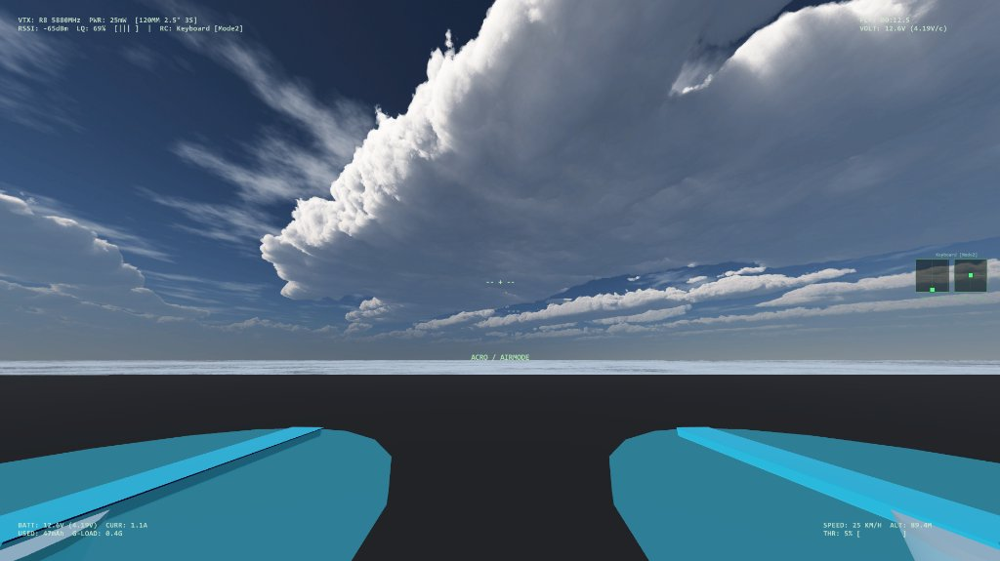
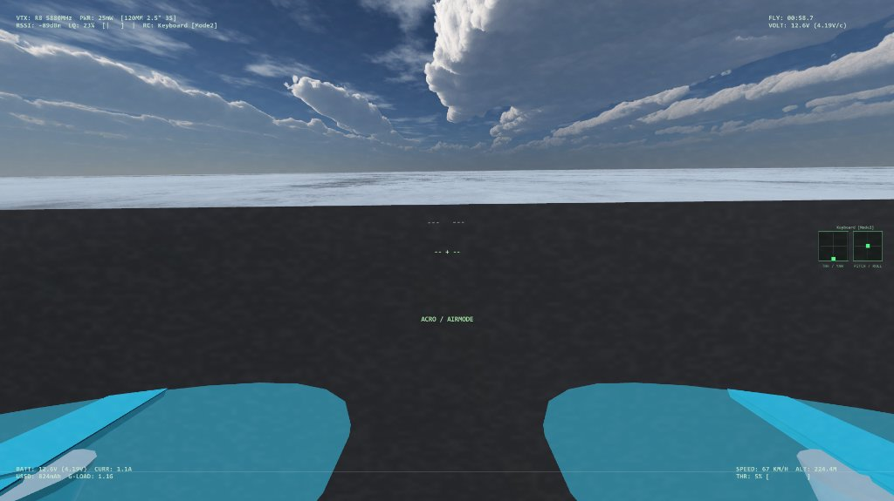
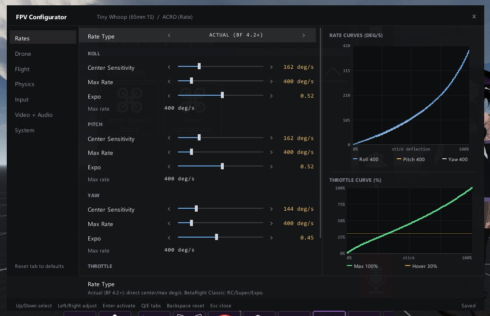
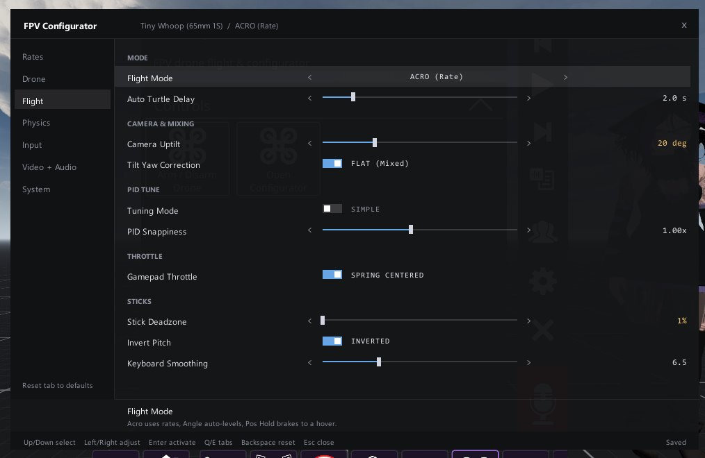
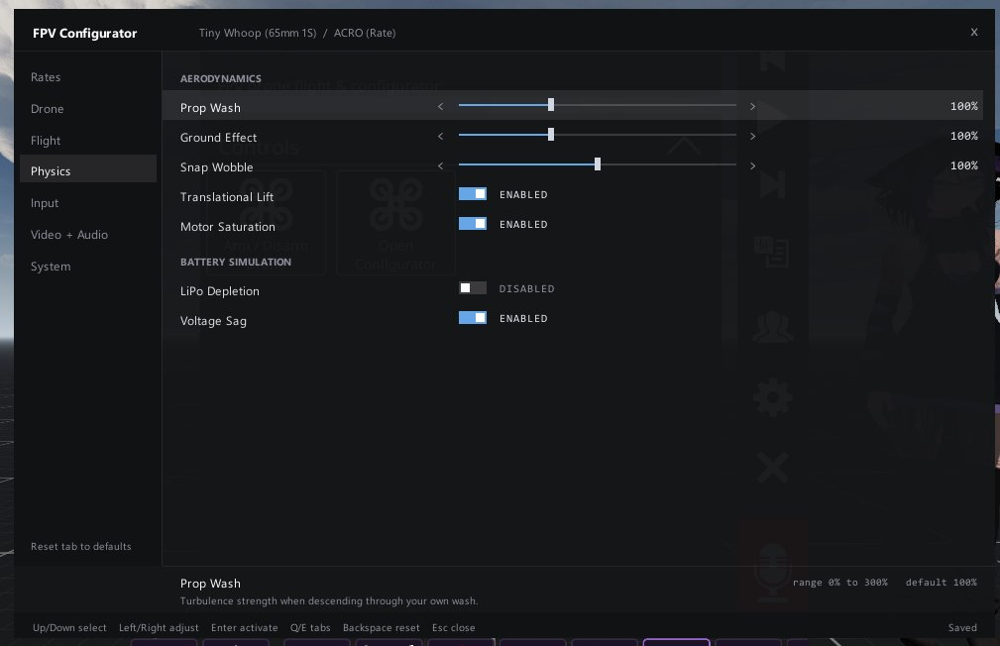
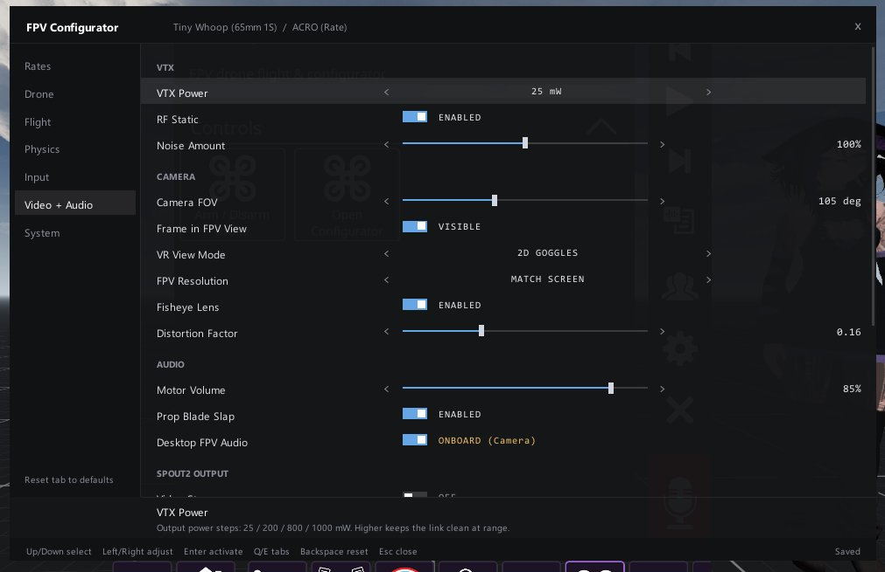

# FPV Drone

FPV drone flight mod for ChilloutVR. Enable the mod from the `FPV Drone` Quick Menu tab, then arm or configure with `F6` / `F7`.

## Features
- **Flight Modes & Drone Builder**: Acro (Betaflight rates), Angle (auto-level), and Position Hold, with 5", Tiny Whoop, and 7" presets or custom hardware builds (frames, props, motors/KV, LiPo, ESC, live Est. Max Speed readout, and an optional World Collisions noclip toggle).
- **Inputs**: USB RC transmitters (EdgeTX/OpenTX) are highly recommended; Xbox gamepad at the very least (keyboard is also supported). Buttons are remappable in the configurator.
- **Audio & Visuals**: 4-motor spatial audio, desktop/VR FPV goggle view (VR mode is still a work in progress and needs a lot of work), optional VTX static & battery simulation, Betaflight-style OSD, and Spout2 output.
- **Multiplayer**: Syncs CVR's native camera indicator to the drone's position, or binds/auto-spawns a synchronized CVR spawnable drone prop ([Custom Prop Guide](PROP_GUIDE.md)).

## Default Controls
| Action | Keyboard | Gamepad |
|---|---|---|
| **Arm / Disarm** | `F6` | Select / View |
| **Configurator Menu** | `F7` | Start / Menu |
| **Flight Mode** | `N` | `B` |
| **Turtle Flip** | `Space` / `T` | `X` |
| **Reset Drone** | `F8` | `Y` |
| **Disarm / Exit** | `Esc` / `Tab` | - |

Screenshots

| | |
|---|---|
|  |  |
|  |  |
|  |  |
|  | |

## Community
Join the [Discord](https://discord.gg/3mA55eQZrR) to share your builds and clips, report bugs, and suggest new features!
