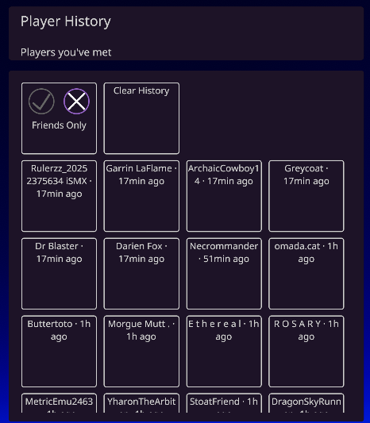

# Player History

Logs players who enter your instance to `UserData/PlayerHistory.tsv`. Stores up to 10 encounter timestamps per player for the most recent 200 players.

## Features

Accessed via the **Player History** tab in the Quick Menu:

- **Player List**: Displays recorded players sorted by last seen date with relative timestamps.
- **Encounter Details**: Selecting a player shows recorded timestamps and world names.
- **Friends Only**: Filters list to current friends.
- **Clear History**: Wipes stored history records.
- **Player Select Panel**: Displays last seen status when selecting a player in the CVR Quick Menu.
